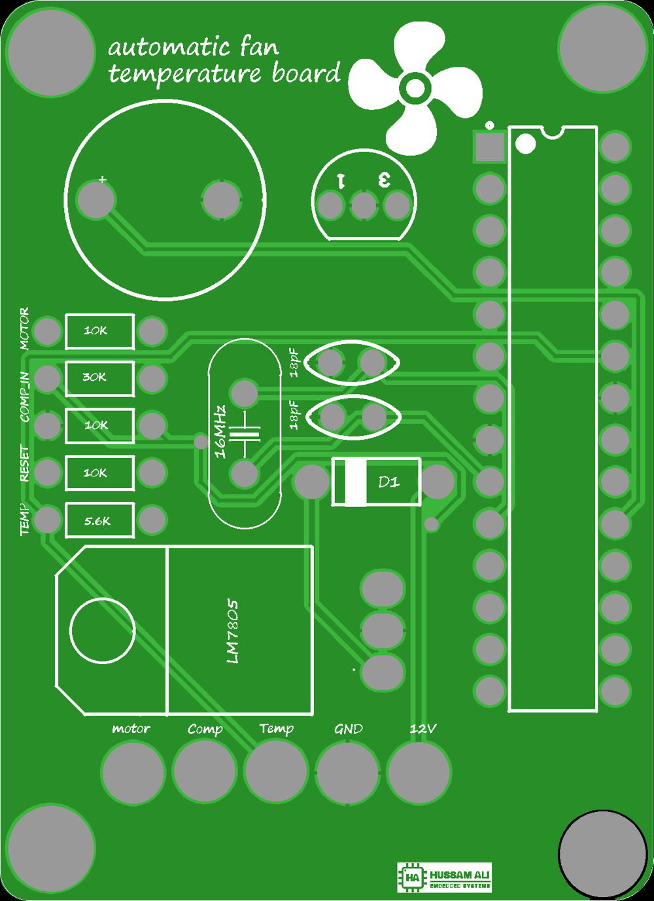

# AFC — Automatic Fan Controller

A temperature-controlled fan driver: it reads an NTC thermistor, converts the reading to °C with the **Beta model**, and drives the fan with a PWM duty cycle proportional to temperature. If the sensor is disconnected or out of range, it fails safe — the fan goes to full speed and the buzzer sounds.

Built and used on real hardware. Designed in **Altium Designer**, with firmware for **PIC16F887**, **ATmega328P** and **Arduino**.

---

## 01. How it works

```
 NTC thermistor ──► ADC ──► Beta-model temperature ──► map(T) ──► PWM ──► fan driver
                                     │
                                     └── out-of-range reading ──► fan 100 % + buzzer
```

| Temperature | Fan output |
|---|---|
| Below `T_min` | Off / idle |
| `T_min` … `T_max` | PWM duty mapped linearly to temperature |
| Above `T_max` | 100 % |
| Sensor open / shorted | 100 % + buzzer alarm |

Temperature is calculated from the thermistor resistance with the Beta equation:

```
1/T = 1/T0 + (1/B) · ln(R / R0)        T0 = 25 °C, R0 = 5.684 kΩ, B = 3965
```

The PIC version generates PWM in software from **CCP1 compare + Timer1** interrupts, so the period and duty are fully controlled in firmware.

---

## 02. Hardware versions

| Version | MCU | Notes |
|---|---|---|
| v1 | PIC16F887 @ 8 MHz | First board — see `PCB/PCB.png` |
| v2 | ATmega328P @ 16 MHz | 2-layer, 40 × 55 mm, 12 V input, on-board 5 V regulator, compressor-signal input, buzzer |
| v2.1 | ATmega328P @ 16 MHz | Same circuit as v2 — silkscreen and title block updated |

---

### v2.1 board — top view

<p align="center"></p>

Manufacturing files: `PCB/Version_2/AFC_AVR/Project Outputs for AFC_AVR/` (`Gerber/` and `NC Drill/`).

---

## 03. Repository layout

| Folder | Contents |
|---|---|
| `PCB/Version_2/AFC_AVR/` | Altium project — schematic, PCB, libraries, output job |
| `PCB/` | v1 board render |
| `Microchip/AFC_PIC16F887.X/` | PIC16F887 firmware (MPLAB X / XC8) |
| `HEX_File/` | Ready-to-flash PIC builds for different temperature thresholds (45 – 65 °C) |
| `AFC_AVR/` | ATmega328P firmware (PlatformIO) |
| `Arduino/` | Arduino prototype sketches and Fritzing breadboard wiring |

---

## 04. Lessons learned

Reviewing the v2 design later, these are the things I would do differently — and have done in my boards since:

| Issue in v2 | Why it matters | What I do now |
|---|---|---|
| No input/output capacitors on the LM7805 | Linear regulators can oscillate without them, especially on a noisy automotive 12 V rail | 0.33 µF on the input and 0.1 µF on the output, placed close to the regulator |
| No decoupling on the MCU supply pins | Supply noise reaches the ADC and makes temperature readings jumpy | 100 nF on every VCC/AVCC pin, plus 100 nF on AREF |
| Schematic diode value (1N4148) did not match the PCB footprint | A 1N4148 is too weak for a 12 V input, and a schematic/PCB mismatch causes assembly errors | Rectifier rated for the input current, and schematic-to-PCB consistency checked before release |
| No protection on the 12 V compressor-signal input | Automotive lines carry voltage spikes | Divider plus a clamp (zener or TVS) and a small filter capacitor on the MCU pin |

---

## License

GPL-3.0 — see [LICENSE](LICENSE).
